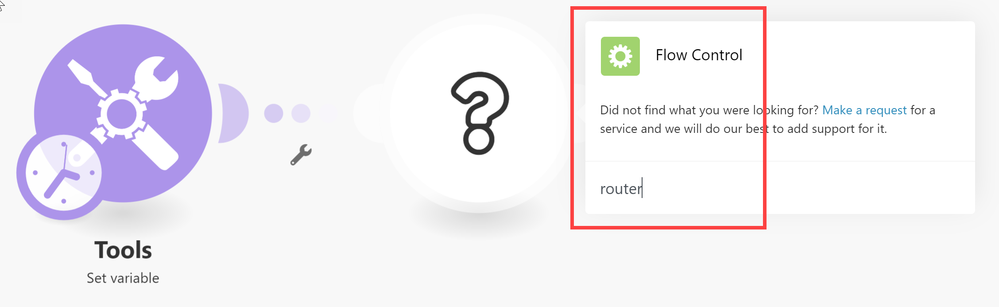

# Ajouter un module Routeur et configurer des itinéraires

Le module Routeur vous permet de diviser votre scénario en plusieurs itinéraires et de traiter les données de chaque itinéraire différemment. Lorsqu&#39;un module de routeur reçoit un lot, il le transmet à chaque route connectée dans l&#39;ordre dans lequel les routes ont été attachées au module de routeur.

Les itinéraires sont traités de manière séquentielle, et non en parallèle. Un bundle n’est pas envoyé vers l’itinéraire suivant tant qu’il n’a pas été complètement traité par l’itinéraire précédent.

>[!NOTE]
>
>Workfront Fusion effectue la transition de l’éditeur de scénarios vers une nouvelle expérience . Au cours de cette transition, les expériences classique et nouvelle sont disponibles et vous pouvez basculer entre elles à tout moment. Nous vous recommandons d’utiliser la nouvelle expérience . Pour plus d’informations, voir [Expériences nouvelles et classiques](/help/workfront-fusion/get-started-with-fusion/navigate-fusion/scenario-editor.md#new-and-classic-experiences) dans l’éditeur de scénarios d’article.

## Conditions d’accès

+++ Développez pour afficher les exigences d’accès aux fonctionnalités de cet article.

<table style="table-layout:auto">
 <col> 
 <col> 
 <tbody> 
  <tr> 
   <td role="rowheader">Package Adobe Workfront</td> 
   <td> 
Tout package de workflow Adobe Workfront et tout package d’automatisation et d’intégration Adobe Workfront

Workfront Ultimate

Packages Workfront Prime et Select, avec l’achat supplémentaire de Workfront Fusion.
 </td> 
  </tr> 
  <tr data-mc-conditions=""> 
   <td role="rowheader">Licences Adobe Workfront</td> 
   <td> 
Standard

Travail ou supérieur
 </td> 
  </tr> 
  <tr> 
   <td role="rowheader">Produit</td> 
   <td>
   
Si votre organisation dispose d’un package Workfront Select ou Prime qui n’inclut pas l’automatisation et l’intégration de Workfront, elle doit acquérir Adobe Workfront Fusion.</li></ul>
   </td> 
  </tr>
 </tbody> 
</table>

Pour plus d’informations sur le contenu de ce tableau, consultez [Conditions d’accès requises dans la documentation](/help/workfront-fusion/references/licenses-and-roles/access-level-requirements-in-documentation.md).

+++

## Ajouter un module Routeur à un scénario

Vous devez ajouter un module Routeur avant de configurer des itinéraires.

* [Ajouter un module Routeur à un scénario dans la nouvelle expérience (Recommandé)](#add-a-router-module-to-a-scenario-in-the-new-experience-recommended)
* [Ajoutez un module Routeur à un scénario dans l’expérience classique](#add-a-router-module-to-a-scenario-in-the-classic-experience)

### Ajouter un module Routeur à un scénario dans la nouvelle expérience (Recommandé)

1. Cliquez sur l’onglet **[!UICONTROL Scénarios]** dans le panneau de gauche.
1. Sélectionnez le scénario dans lequel vous souhaitez ajouter un routeur.
1. Cliquez n’importe où sur le scénario pour accéder à l’éditeur de scénarios.
1. Pointez sur le bord droit du module après lequel vous souhaitez ajouter le routeur, puis cliquez sur **[!UICONTROL Ajouter un autre module]** lorsqu&#39;il apparaît. Dans la liste qui s’ouvre, sélectionnez la catégorie **[!UICONTROL Intégré]**, puis sélectionnez **[!UICONTROL Ordonnancement]** > **[!UICONTROL Routeur]**.

   Ou

   Pour insérer le module Router entre deux modules, cliquez avec le bouton droit de la souris sur le chemin reliant les deux modules, puis sélectionnez **[!UICONTROL Ajouter un routeur]**.

   

1. Ajoutez la première route au routeur en pointant sur le bord droit du routeur et en ajoutant un module, comme pour ajouter un module.
1. Pour ajouter un autre itinéraire, cliquez sur le module de routeur. Un itinéraire s’affiche. Ajoutez des modules à cet itinéraire, si vous le souhaitez.

   Vous pouvez ajouter autant d’itinéraires que vous le souhaitez.

1. Pour vérifier l’ordre des itinéraires, vérifiez le libellé de chaque itinéraire. La route 1 s’exécute en premier, puis la route 2, et ainsi de suite.

   Ou

   Cliquez sur l’icône **Alignement automatique**  dans la zone Contrôles.

   Les itinéraires sont organisés dans l’ordre dans lequel ils s’exécutent. L’itinéraire supérieur s’exécute en premier.

1. (Facultatif) Pour modifier l’ordre des itinéraires, cliquez avec le bouton droit de la souris sur le module Router et sélectionnez **Order routes**. Effectuez un glisser-déposer des itinéraires dans l’ordre dans lequel vous souhaitez qu’ils s’exécutent. Les routes sont marquées par le premier module qui suit le routeur (le premier module de la route).
1. (Facultatif) Pour désactiver un itinéraire, cliquez avec le bouton droit sur le chemin qui mène du routeur à cet itinéraire, et sélectionnez **Désactiver l&#39;itinéraire**.

   Les itinéraires désactivés affichent des points gris menant du routeur au premier module de l&#39;itinéraire, et affichent une icône d&#39;itinéraire désactivé  sur le libellé.

1. (Facultatif et conditionnel) Pour activer un itinéraire désactivé, cliquez sur l’icône d’itinéraire désactivé  sur le libellé de l’itinéraire.
1. Passez à [&#x200B; Ajouter un filtre à un itinéraire dans la nouvelle expérience &#x200B;](#add-a-filter-to-a-route-in-the-new-experience-recommended).

### Ajoutez un module Routeur à un scénario dans l’expérience classique

1. Cliquez sur l’onglet **[!UICONTROL Scénarios]** dans le panneau de gauche.
1. Sélectionnez le scénario dans lequel vous souhaitez ajouter un routeur.
1. Cliquez n’importe où sur le scénario pour accéder à l’éditeur de scénarios.
1. Dans l&#39;éditeur de scénarios, cliquez sur la poignée droite du module après lequel vous souhaitez ajouter le routeur, puis sélectionnez **[!UICONTROL Flow Control]** > **Router** dans la liste des modules qui s&#39;affiche.

   

   Ou

   Pour insérer le module Router entre deux modules, cliquez sur l&#39;icône de clé à molette sous l&#39;itinéraire reliant les deux modules et sélectionnez **[!UICONTROL Ajouter un routeur]** dans le menu.

   
1. Ajoutez la première route au routeur en cliquant sur la poignée droite du routeur et ajoutez un module, comme pour ajouter un module.
1. Pour ajouter un autre itinéraire, cliquez sur le module de routeur. Un itinéraire s’affiche. Ajoutez des modules à cet itinéraire, si vous le souhaitez.

   Vous pouvez ajouter autant d’itinéraires que vous le souhaitez.

1. Pour vérifier l’ordre des itinéraires, vérifiez le libellé de chaque itinéraire. La route 1 s’exécute en premier, puis la route 2, et ainsi de suite.

   Ou

   Cliquez sur l’icône Alignement automatique .

   Les itinéraires sont organisés dans l’ordre dans lequel ils s’exécutent. L’itinéraire supérieur s’exécute en premier.

1. (Facultatif) Pour modifier l’ordre des itinéraires, cliquez avec le bouton droit de la souris sur le module Router et sélectionnez **Ordre des itinéraires** Faites glisser les itinéraires dans l’ordre dans lequel vous souhaitez qu’ils s’exécutent. Les routes sont marquées par le premier module qui suit le routeur (le premier module de la route).

   

1. (Facultatif) Pour désactiver une route, cliquez avec le bouton droit sur les points qui mènent du routeur à cette route, et sélectionnez **Désactiver la route**.

   Les itinéraires désactivés affichent des points gris menant du routeur au premier module de l&#39;itinéraire, et affichent une icône d&#39;itinéraire désactivé  sur le libellé.

1. (Facultatif et conditionnel) Pour activer un itinéraire désactivé, cliquez sur l’icône d’itinéraire désactivé  sur le libellé de l’itinéraire.
1. Passez à [&#x200B; Ajouter un filtre à un itinéraire dans l’expérience classique &#x200B;](#add-a-filter-to-a-route-in-the-classic-experience).

## Ajouter un filtre à un itinéraire

Vous pouvez placer un filtre sur un itinéraire après le module Routeur pour filtrer les lots. Seuls les lots qui passent par le filtre seront gérés par les modules sur l’itinéraire.

Si les données franchissent le filtre de plusieurs itinéraires, les données sont gérées par les deux itinéraires. L’itinéraire supérieur gère d’abord les données.

Les routeurs avec filtres affichent l’icône de filtre  sur le libellé de l’itinéraire.

* [Ajouter un filtre à un itinéraire dans la nouvelle expérience (Recommandé)](#add-a-filter-to-a-route-in-the-new-experience-recommended)
* [Ajouter un filtre à un itinéraire dans l’expérience classique](#add-a-filter-to-a-route-in-the-classic-experience)

### Ajouter un filtre à un itinéraire dans la nouvelle expérience (Recommandé)

1. Cliquez sur l’onglet **[!UICONTROL Scénarios]** dans le panneau de gauche.
1. Sélectionnez le scénario dans lequel vous souhaitez ajouter un filtre.
1. Cliquez n’importe où sur le scénario pour accéder à l’éditeur de scénarios.
1. Cliquez avec le bouton gauche de la souris sur le chemin d’accès où vous souhaitez définir un filtre. Il s&#39;agit du chemin entre le module de routage et le premier module de la route.

   La fenêtre **[!UICONTROL Configurer un filtre]** s’ouvre directement.

1. Dans le champ libellé du panneau qui s’affiche, ajoutez un libellé. Ce libellé s’affiche dans le scénario.
1. Configurez les conditions de filtrage.

   Pour plus d’informations, consultez [Ajouter un filtre à un scénario](/help/workfront-fusion/create-scenarios/add-modules/add-a-filter-to-a-scenario.md).

   

1. Cliquez sur **[!UICONTROL OK]** pour enregistrer la configuration des filtres.
1. (Conditionnel) Si le nom du filtre est trop long pour tenir dans le libellé, pointez sur le libellé pour afficher le nom entier.

1. Passez à [&#x200B; Configurer un itinéraire de secours dans la nouvelle expérience &#x200B;](#configure-a-fallback-route-in-the-new-experience-recommended).

### Ajouter un filtre à un itinéraire dans l’expérience classique

1. Cliquez sur l’onglet **[!UICONTROL Scénarios]** dans le panneau de gauche.
1. Sélectionnez le scénario dans lequel vous souhaitez ajouter un filtre.
1. Cliquez n’importe où sur le scénario pour accéder à l’éditeur de scénarios.
1. Cliquez sur l’icône clé à molette  sur le chemin d’accès où vous souhaitez définir un filtre. Il s&#39;agit du chemin entre le module de routage et le premier module de la route.
1. Sélectionnez **Configurer un filtre.**
1. Dans le champ libellé du panneau qui s’affiche, ajoutez un libellé. Ce libellé s’affiche dans le scénario.
1. Configurez les conditions de filtrage.

   Pour plus d’informations, consultez [Ajouter un filtre à un scénario](/help/workfront-fusion/create-scenarios/add-modules/add-a-filter-to-a-scenario.md).

1. Cliquez sur **[!UICONTROL OK]** pour enregistrer la configuration des filtres.
1. (Conditionnel) Si le nom du filtre est trop long pour tenir dans le libellé, pointez sur le libellé pour afficher le nom entier.

1. Passez à [&#x200B; Configurer un itinéraire de secours dans l’expérience classique &#x200B;](#configure-a-fallback-route-in-the-classic-experience).

## Configuration d’un itinéraire de secours

L’itinéraire de secours est l’itinéraire qui s’exécute sur les lots qui ne transmettent aucun filtre à un autre itinéraire.

Les itinéraires de secours affichent « Secours » sur l’étiquette.

Vous pouvez activer un itinéraire de secours dans le panneau de filtrage.

* [Configurer un itinéraire de secours dans la nouvelle expérience (Recommandé)](#configure-a-fallback-route-in-the-new-experience-recommended)
* [Configurer un itinéraire de secours dans l’expérience classique](#configure-a-fallback-route-in-the-classic-experience)

### Configurer un itinéraire de secours dans la nouvelle expérience (Recommandé)

1. Cliquez sur l’onglet **[!UICONTROL Scénarios]** dans le panneau de gauche.
1. Sélectionnez le scénario dans lequel vous souhaitez ajouter un itinéraire de secours.
1. Cliquez n’importe où sur le scénario pour accéder à l’éditeur de scénarios.
1. Cliquez avec le bouton gauche de la souris sur le chemin d’accès où vous souhaitez définir un filtre. Il s&#39;agit du chemin entre le module de routage et le premier module de la route.

   La fenêtre **[!UICONTROL Configurer un filtre]** s’ouvre directement.

1. Dans le champ libellé du panneau qui s’affiche, ajoutez un libellé. Ce libellé s’affiche dans le scénario.
1. Cochez la case itinéraire de secours .

   

1. Cliquez sur **[!UICONTROL OK]** pour enregistrer la configuration des filtres.

Le libellé de l’itinéraire de secours s’affiche en vert **Fallback**.

### Configurer un itinéraire de secours dans l’expérience classique

1. Cliquez sur l’onglet **[!UICONTROL Scénarios]** dans le panneau de gauche.
1. Sélectionnez le scénario dans lequel vous souhaitez ajouter un itinéraire de secours.
1. Cliquez n’importe où sur le scénario pour accéder à l’éditeur de scénarios.
1. Cliquez sur l’icône clé à molette  sur le chemin d’accès où vous souhaitez définir un filtre. Il s&#39;agit du chemin entre le module de routage et le premier module de la route.
1. Sélectionnez **Configurer un filtre.**
1. Dans le champ libellé du panneau qui s’affiche, ajoutez un libellé. Ce libellé s’affiche dans le scénario.
1. Cochez la case itinéraire de secours .

   

1. Cliquez sur **[!UICONTROL OK]** pour enregistrer la configuration des filtres.

L’itinéraire de secours est signalé par une flèche différente dans le module Router :

## Replier un routeur

>[!NOTE]
>
>Cette fonctionnalité n’est disponible que dans la nouvelle expérience de l’éditeur de scénarios.

Dans la nouvelle expérience, vous pouvez plier un routeur pour masquer temporairement ses itinéraires. Cela s’avère utile dans les scénarios volumineux.

1. Ouvrez le scénario dans l’éditeur de scénarios, en mode d’édition.
1. Cliquez avec le bouton droit sur le routeur que vous souhaitez replier, puis sélectionnez **Replier les itinéraires**

Le routeur plié montre le nombre d&#39;itinéraires et de modules masqués, y compris la gravité de tous les avertissements ou erreurs masqués.

Le pliage d&#39;un routeur ne supprime ou ne désactive rien. Les historiques de recherche, de validation, de Live Trail et d’exécution étendent automatiquement un routeur plié lorsqu’ils doivent afficher un module qui s’y trouve.

L’état replié est enregistré avec le scénario et fonctionne avec les options Annuler et Rétablir. Lorsque vous vérifiez l’exécution d’un scénario, le scénario complet s’affiche toujours.

## Exemple : cas d’utilisation `if/else`

>[!BEGINSHADEBOX]

Un cas d’utilisation type de la route de secours consiste à poursuivre le flux avec une route si la condition est remplie et avec une autre route si elle ne l’est pas. comme dans les étapes suivantes :

Dans cet exemple, le premier itinéraire est configuré avec un filtre. Il s’agit du composant `if`.

La deuxième route est configurée comme route de secours. Il s’agit du composant `else`.

>[!ENDSHADEBOX]
