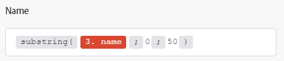
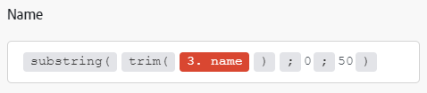
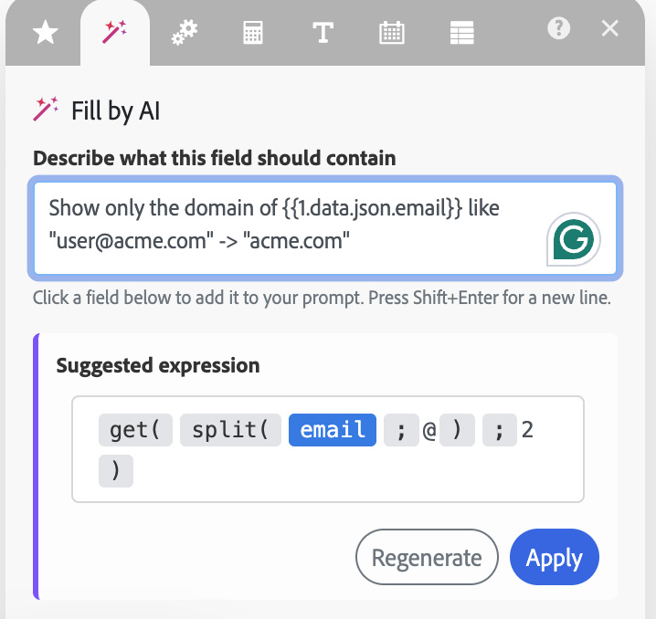
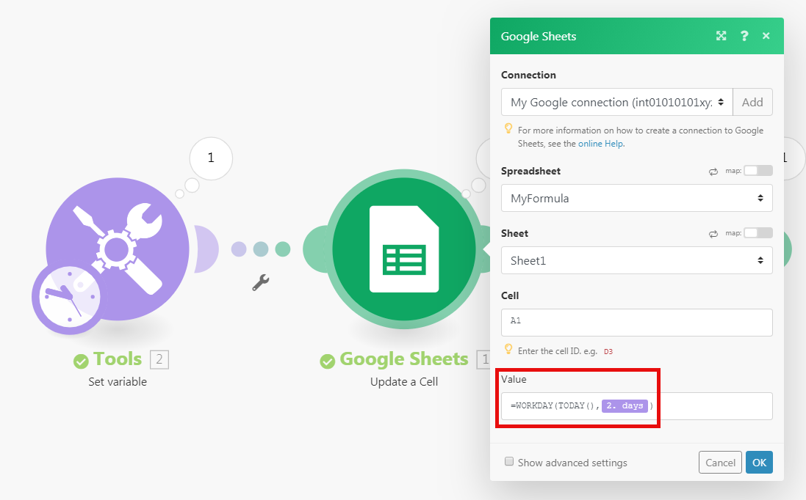
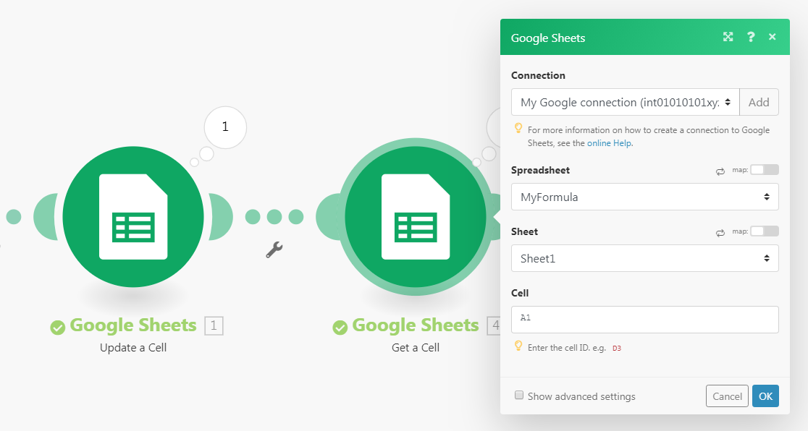

# Mappage d’un élément à l’aide de fonctions intégrées

Workfront Fusion inclut des fonctions intégrées qui vous permettent de créer des formules simples ou complexes. Ces fonctions couvrent un large éventail de cas d’utilisation, y compris les fonctions pour les tableaux, les chaînes, les nombres et les données des modules précédents.

En outre, vous pouvez créer des fonctions et des packages personnalisés que vos scénarios peuvent utiliser pour transformer et manipuler les données.

Pour plus d&#39;informations et d&#39;instructions sur les fonctions personnalisées, voir [Mapper des données à l&#39;aide de fonctions personnalisées](/help/workfront-fusion/create-scenarios/map-data/map-using-custom-functions.md).

Pour obtenir des informations et des instructions sur les packages de fonctions, voir [Utiliser des packages de fonctions personnalisés](/help/workfront-fusion/create-scenarios/map-data/use-custom-function-packages.md).

## Conditions d’accès

+++ Développez pour afficher les exigences d’accès aux fonctionnalités de cet article.

<table style="table-layout:auto">
 <col> 
 <col> 
 <tbody> 
  <tr> 
   <td role="rowheader">Package Adobe Workfront</td> 
   <td> 
Tout package de workflow Adobe Workfront et tout package d’automatisation et d’intégration Adobe Workfront

Workfront Ultimate

Packages Workfront Prime et Select, avec l’achat supplémentaire de Workfront Fusion.
 </td> 
  </tr> 
  <tr data-mc-conditions=""> 
   <td role="rowheader">Licences Adobe Workfront</td> 
   <td> 
Standard

Travail ou supérieur
 </td> 
  </tr> 
  <tr> 
   <td role="rowheader">Produit</td> 
   <td>
   
<ul><li>Si votre organisation dispose d’un package Workfront Select ou Prime qui n’inclut pas l’automatisation et l’intégration de Workfront, elle doit acquérir Adobe Workfront Fusion.</li><li>Vous devez disposer d’une licence Adobe App Builder pour utiliser des fonctions personnalisées.</ul>
   </td> 
  </tr>
 </tbody> 
</table>

Pour plus d’informations sur le contenu de ce tableau, consultez [Conditions d’accès requises dans la documentation](/help/workfront-fusion/references/licenses-and-roles/access-level-requirements-in-documentation.md).

+++

## Mappage de données à l’aide de fonctions intégrées

Lorsque vous mappez des éléments, vous pouvez utiliser des fonctions pour créer des formules simples ou complexes. Les fonctions disponibles sont similaires aux fonctions d’Excel et de certains langages de programmation :

* Elles évaluent la logique générale, les maths, le texte, les dates et les tableaux.
* Elles vous permettent d’effectuer une logique conditionnelle et des transformations des valeurs d’élément, comme convertir du texte en majuscules, rogner du texte, convertir une date dans un format différent, etc.

### Insérer des fonctions dans les champs

Pour insérer une fonction dans un champ, procédez comme suit :

1. Cliquez sur l’onglet **[!UICONTROL Scénarios]** dans le panneau de gauche.
1. Sélectionnez le scénario dans lequel vous souhaitez mapper les données.
1. Cliquez n’importe où sur le scénario pour accéder à l’éditeur de scénarios.
1. Cliquez sur le champ dans lequel vous souhaitez insérer une fonction.
1. Sélectionnez l’onglet dans le panneau de mappage qui contient la fonction que vous souhaitez insérer.

   Pour plus d’informations sur les onglets du panneau de mappage, consultez [Présentation des fonctions](/help/workfront-fusion/get-started-with-fusion/understand-fusion/function-overview.md)
1. Cliquez sur le nom de la fonction.

   Ou

   Faites glisser la fonction dans le champ.
1. Configurez les paramètres de la fonction .

   Pour obtenir une explication des paramètres de fonction, passez la souris sur la fonction dans le panneau de mappage.

   Pour plus d&#39;informations sur les fonctions et leurs paramètres, consultez les articles sous [Références de fonction : index d&#39;article](/help/workfront-fusion/references/mapping-panel/functions/functions-toc.md).

1. Continuez à configurer le module ou cliquez sur **OK**.

>[!TIP]
>
>Lorsque vous créez une formule complexe que vous souhaitez réutiliser dans un autre champ, vous pouvez cliquer sur le champ contenant la combinaison, utiliser Cmd-A ou Ctrl-A pour la sélectionner, puis la copier et la coller dans l&#39;autre champ.

>[!BEGINSHADEBOX]

**Exemple :** certains types de données empêchent les utilisateurs et utilisatrices de saisir plus d’un certain nombre de caractères. Vous pouvez utiliser la fonction substring pour limiter une valeur à un certain nombre de caractères.

Dans cet exemple, la fonction substring limite le nom du projet à 50 caractères.

>[!ENDSHADEBOX]

### Imbriquer des fonctions

Vous pouvez imbriquer des fonctions entre elles.

>[!BEGINSHADEBOX]

**Exemple :**

Dans cet exemple, la fonction sous-chaîne limite le nom du projet tronqué à 50 caractères.

>[!ENDSHADEBOX]

Pour imbriquer une fonction :

1. Cliquez sur le champ dans lequel vous créez une formule.

   Le panneau de mappage s’ouvre.

1. Cliquez sur la première fonction que vous souhaitez ajouter. C&#39;est la fonction à l&#39;extérieur. Si l&#39;exemple suivant, il s&#39;agit de la fonction `substring`.
1. Dans cette fonction, cliquez où vous souhaitez que la fonction imbriquée aille. Dans cet exemple, la fonction imbriquée remplace le premier paramètre.
1. Dans le panneau de mappage, cliquez sur la fonction imbriquée . Dans cet exemple, il s’agit de la fonction `trim`.
1. Continuez à configurer la fonction selon vos besoins.
1. Continuez à configurer le module ou cliquez sur **OK**.

### Générer une expression avec l’IA

Au lieu d’écrire la syntaxe d’une expression vous-même, vous pouvez décrire ce que vous souhaitez en langage simple, et l’IA génère l’expression pour vous. Par exemple, vous pouvez demander ce qui suit :

* Joignez ces noms par une virgule.
* Ajoutez trois jours à la date d&#39;échéance.

L’IA transforme votre requête en expression qui utilise les fonctions intégrées de Workfront Fusion. De ce fait, le résultat est lisible et facile à vérifier avant de l’utiliser.

Pour générer une expression :

1. Cliquez sur l’onglet **[!UICONTROL Scénarios]** dans le panneau de gauche.
1. Sélectionnez le scénario dans lequel vous souhaitez mapper les données.
1. Cliquez n’importe où sur le scénario pour accéder à l’éditeur de scénarios.
1. Cliquez sur le module dans lequel vous souhaitez ajouter une expression, puis sur le champ .

   Le panneau de mappage s’ouvre.

1. Cliquez sur l’onglet **[!UICONTROL Remplir par l’IA]** (icône de baguette magique) dans le panneau de mappage.

   

1. Dans la zone **[!UICONTROL Décrire ce que ce champ doit contenir]**, décrivez le résultat souhaité en langage clair.

   Pour ajouter à votre invite un champ provenant d&#39;un module précédent, cliquez dessus dans la liste **[!UICONTROL Champs disponibles]**. Pour commencer une nouvelle ligne dans l&#39;invite, appuyez sur Maj + Entrée.

   Par exemple, pour obtenir uniquement le domaine à partir d’une adresse e-mail, vous pouvez saisir l’invite suivante :

   `Show only the domain of {{1.data.json.email}} like "user@acme.com" -> "acme.com"`

1. Cliquez sur **[!UICONTROL Générer]**.

   L’expression générée par AI apparaît sous **[!UICONTROL Expression suggérée]**.

   

1. Vérifiez l’expression, puis effectuez l’une des opérations suivantes :

   * Cliquez sur **[!UICONTROL Appliquer]** pour insérer l&#39;expression dans le champ.
   * Cliquez sur **[!UICONTROL Régénérer]** pour que l’IA génère une expression différente.

1. (Facultatif) Modifiez l’expression dans le champ, le cas échéant.

1. Continuez à configurer le module ou cliquez sur **[!UICONTROL OK]**.

#### Comment l’IA génère des expressions

Lorsque l’IA génère une expression, elle effectue les opérations suivantes :

* **Utilise le contexte de votre scénario.** L’IA prend en compte les champs qui sont disponibles pour le mappage, leurs types, le champ de destination, ainsi que vos paramètres régionaux et vos paramètres de fuseau horaire.
* **Valide l’expression.** Avant que l’IA ne renvoie une expression comme réussie, elle recherche les fonctions non prises en charge, les arguments manquants, les références de champ inconnues et les erreurs courantes avec les tableaux et les dates.
* **Corrige et simplifie l&#39;expression.** L’IA corrige les erreurs de syntaxe courantes et remplace les solutions de contournement reconnues par des fonctions intégrées.
* **Réessai en cas d&#39;échec de la validation.** L’IA utilise les commentaires spécifiques de la validation pour régénérer l’expression. S’il ne peut toujours pas créer d’expression valide, il renvoie une erreur claire au lieu d’un résultat non valide.

>[!NOTE]
>
>Les expressions générées par l’IA peuvent être incomplètes ou inexactes. Passez en revue chaque expression et testez votre scénario avant de vous fier au résultat.

### Utiliser des fonctions [!DNL Google Sheets]

Si Workfront Fusion ne dispose pas d’une fonction que vous souhaitez utiliser, mais qu’elle est proposée par [!DNL Google Sheets], vous pouvez l’utiliser en suivant ces étapes :

1. Dans [!DNL Google Sheets], créez une feuille de calcul vide.
1. Dans Workfront Fusion, ouvrez votre scénario.
1. Ajoutez le module **[!DNL Google Sheets]** > **[!UICONTROL Mettre à jour une cellule]** au scénario.

1. Configurez le module :

   1. Sélectionnez la feuille de calcul nouvellement créée dans le champ **[!UICONTROL Feuille de calcul]**.
   1. Insérez votre formule contenant la ou les fonctions [!DNL Google Sheets] dans le champ **[!UICONTROL Valeur]**.

      Vous pouvez utiliser la sortie des modules précédents comme vous le faites habituellement.

      

1. Insérez le module **[!UICONTROL Google Sheets] > [!UICONTROL Obtenir une cellule]** pour obtenir le résultat calculé.
1. Configurez le module à l’aide du même ID de cellule que celui utilisé à l’étape 4.

   

