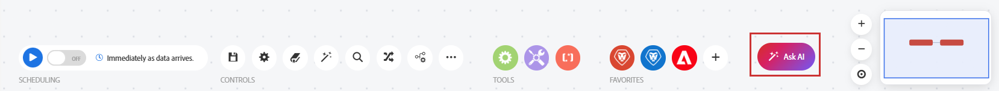

# Éditeur de scénarios

L’éditeur de scénario vous permet de créer et de modifier des scénarios dans une interface visuelle.

La nouvelle expérience de l’éditeur de scénarios :

Expérience de l’éditeur de scénario classique

## Conditions d’accès

+++ Développez pour afficher les exigences d’accès aux fonctionnalités de cet article.

<table style="table-layout:auto">
 <col> 
 <col> 
 <tbody> 
  <tr> 
   <td role="rowheader">Package Adobe Workfront</td> 
   <td> 
Tout package de workflow Adobe Workfront et tout package d’automatisation et d’intégration Adobe Workfront

Workfront Ultimate

Packages Workfront Prime et Select, avec l’achat supplémentaire de Workfront Fusion.
 </td> 
  </tr> 
  <tr data-mc-conditions=""> 
   <td role="rowheader">Licences Adobe Workfront</td> 
   <td> 
Standard

Travail ou supérieur
 </td> 
  </tr> 
  <tr> 
   <td role="rowheader">Produit</td> 
   <td>
   
Si votre organisation dispose d’un package Workfront Select ou Prime qui n’inclut pas l’automatisation et l’intégration de Workfront, elle doit acquérir Adobe Workfront Fusion.</li></ul>
   </td> 
  </tr>
 </tbody> 
</table>

Pour plus d’informations sur le contenu de ce tableau, consultez [Conditions d’accès requises dans la documentation Workfront](/help/workfront-fusion/references/licenses-and-roles/access-level-requirements-in-documentation.md).

+++

## Expériences nouvelles et classiques

Workfront Fusion effectue la transition de l’éditeur de scénarios vers une nouvelle expérience . Au cours de cette transition, les expériences classique et nouvelle sont disponibles et vous pouvez basculer entre elles à tout moment. Nous vous recommandons d’utiliser la nouvelle expérience .

La nouvelle expérience comprend les éléments suivants :

* Zone de travail repensée, avec des modules de style carte, un écran et des commandes de zoom.
* Nouveaux contrôles de l’éditeur de scénarios, notamment Rechercher et remplacer, Fragments de code et Annuler/rétablir.
* Bouton Demander à l’IA .
* Sélecteur de connecteur mis à jour avec navigation par catégorie et possibilité de marquer les favoris en ligne.
* Mode sombre qui suit votre paramètre d’apparence.
* La possibilité de plier un routeur pour masquer ses itinéraires.
* [Live Trail](/help/workfront-fusion/manage-scenarios/live-trail.md), un panneau qui affiche l’exécution d’un scénario.
* Plusieurs outils de développement sont désormais intégrés à l’éditeur de scénarios.
* Journaux de débogage temporaires, que vous pouvez activer dans les paramètres du scénario.

Pour basculer entre les expériences classiques et les nouvelles expériences :

1. Dans l’éditeur de scénarios, localisez le bouton bascule **[!UICONTROL Essayer la nouvelle conception]** dans le coin supérieur droit.
1. Cliquez sur le bouton pour passer à la nouvelle expérience.
1. Pour revenir à l’expérience classique, cliquez de nouveau sur le bouton (bascule).

Le scénario se recharge lorsque vous basculez. Votre choix est enregistré pour votre utilisateur, il ne modifie donc pas l’expérience que voient vos coéquipiers. Le changement ne modifie pas le scénario lui-même.

Si vous ne voyez pas le bouton (bascule), il se peut que la nouvelle expérience ne soit pas encore disponible pour votre organisation. Contactez votre administrateur Workfront Fusion.

## Utiliser l’éditeur de scénarios dans la nouvelle expérience (recommandé)

* [Ouvrez l’éditeur de scénarios et ajoutez un module :](#open-the-scenario-editor-and-add-a-module)
* [Actions disponibles dans l’éditeur de scénario](#available-scenario-editor-actions)

### Ouvrez l’éditeur de scénarios et ajoutez un module :

1. Cliquez sur **[!UICONTROL Scénarios]**  dans le panneau de gauche.
1. Cliquez sur le module d’espace réservé pour ouvrir la liste des applications et services.
1. Sélectionnez l’application ou le service avec lequel vous souhaitez commencer :

   * Parcourez les ressources par catégorie à l’aide du panneau de gauche ([!UICONTROL Favoris], [!UICONTROL Toutes les applications], [!UICONTROL Adobe Workfront], [!UICONTROL Adobe Firefly Services], [!UICONTROL Adobe Creative &amp; Content], [!UICONTROL Adobe Cloud Services], [!UICONTROL IA générative] ou [!UICONTROL Built]).
   * Saisissez un terme dans la zone de recherche pour filtrer la liste.
   * Pour ajouter un connecteur à vos favoris, pointez sur le connecteur, puis cliquez sur l’icône en forme d’étoile à côté du connecteur.

   Pour plus d’informations sur la configuration d’un module, voir [Configuration d’un module](/help/workfront-fusion/create-scenarios/add-modules/configure-a-modules-settings.md).

### Actions disponibles dans l’éditeur de scénario

* [Modifier les actions](#editing-actions)
* [Planification](#scheduling)
* [Commandes](#controls)
* [Outils](#tools)
* [Favoris](#favorites)
* [Demander à l’IA](#ask-ai)
* [Navigation dans la zone de travail](#canvas-navigation)
* [Affichage de la zone de travail](#canvas-display)

#### Modifier les actions

Ces actions sont disponibles dans la partie supérieure de l’écran, plutôt que dans la barre d’outils inférieure.

| Action | Détails |
| ---------- | ---------- |
| Nom du scénario | Le nom du scénario s’affiche dans le coin supérieur gauche de l’écran. Pour renommer le scénario, cliquez sur son nom et saisissez-en un nouveau. |
| Vue compacte | Activez/désactivez une vue dans laquelle les modules de la zone de travail rétrécissent en petites mosaïques, la grille se resserre et les longs noms de module s’encapsulent au lieu d’être coupés. Le changement de vue ne recharge pas le scénario. |
| Commentaires | Envoyez vos commentaires sur la nouvelle expérience. Ce bouton se trouve dans le coin supérieur droit de l’éditeur de scénarios, à côté du bouton (bascule) Affichage compact . |
| Annuler   | Annulez les actions les plus récentes, en commençant par la plus récente. Vous ne pouvez annuler que des actions de la session en cours. |
| Rétablir   | Rétablir les actions récentes. Vous ne pouvez rétablir que les actions de la session en cours. |
| Historique   | Affichez l’historique des modifications apportées au cours de cette session. Vous pouvez également annuler toutes les modifications de session. |

#### Planification

| Action | Détails |
| ---------- | ---------- |
| Exécuter une fois | Exécuter une fois est réservé à l’icône dans la nouvelle conception. Pointez sur l’icône pour afficher l’info-bulle **[!UICONTROL Exécuter une fois]**. Ici, vous pouvez tester le scénario et vérifier qu’il s’exécute comme prévu avant de l’activer |
| Bouton Activation | Activez ou désactivez votre scénario. Une fois activé, le scénario s’exécute selon son planning. |
| Planifier le scénario | Par défaut, un scénario avec un déclencheur d’interrogation s’exécute toutes les 15 minutes. Vous pouvez modifier ce paramètre en définissant le moment et la fréquence d’exécution d’un scénario activé. Les scénarios de fusion interrogés peuvent être planifiés pour s’exécuter aussi souvent que toutes les 5 minutes. Pour plus d’informations, voir [ Planification d’un scénario ](/help/workfront-fusion/create-scenarios/config-scenarios-settings/schedule-a-scenario.md). |

#### Commandes

Vous devrez peut-être cliquer sur l&#39;icône des trois points dans la zone Contrôles pour afficher certains de ces contrôles.

| Action | Détails |
| ---------- | ---------- |
| Enregistrez. 

 | 
Après avoir enregistré votre scénario, une nouvelle version est disponible dans le menu à trois points si vous avez besoin d’y accéder ultérieurement. Les versions de scénario enregistrées précédemment sont disponibles pendant 60 jours après la création de la version de scénario suivante. 

Pour conserver l’historique des versions du scénario au-delà de 60 jours à des fins d’audit, nous vous recommandons d’enregistrer et d’archiver un plan directeur du scénario à un autre emplacement.
 |
| Paramètres du scénario 

 | Le panneau des paramètres du scénario contient des paramètres avancés pour le scénario. Pour plus d’informations sur les paramètres disponibles, voir [Configurer les paramètres de scénario](/help/workfront-fusion/create-scenarios/config-scenarios-settings/configure-scenario-settings.md). Les détails de la requête et de la réponse ne sont pas conservés pour chaque exécution. Pour les collecter pour les exécutions régulières du scénario, activez les journaux de débogage temporaires. Pour plus d’informations, voir [ Journaux de débogage temporaires ](/help/workfront-fusion/create-scenarios/config-scenarios-settings/configure-scenario-settings.md#temporary-debug-logs). |
| Notes 

 | Prenez des notes sur le scénario. Les autres utilisateurs peuvent afficher ces notes lorsqu’ils se trouvent dans le scénario. Pour plus d’informations, voir [Ajouter des notes à un scénario](/help/workfront-fusion/create-scenarios/config-scenarios-settings/add-notes-to-scenario.md). |
| Auto-align 

 | Alignement automatique des modules dans votre scénario. |
| Modules de recherche 

 | Sélectionnez un module dans la liste pour accéder à ce module dans le scénario, ou saisissez un terme de recherche pour localiser un module, puis cliquez sur les résultats de la recherche pour accéder à ce module. Vous pouvez effectuer une recherche par nom de module, ID, type ou application. |
| Recherche et remplacement 

 | 
Recherchez et remplacez des variables, des sources de valeurs mappées ou des connexions dans les modules du scénario. Utilisez les onglets pour :
<ul><li>Remplacez une variable mappée sur l’ensemble du scénario ou dans un seul module.</li><li>Remapper des références d’un module source à un autre.</li><li>Copiez une connexion vers un ou tous les modules compatibles depuis la même application.</li></ul>
Le panneau prévisualise les modules qui seront affectés avant d’effectuer la modification. Sélectionnez une ligne dans l’aperçu pour accéder à ce module sur la zone de travail.
 
Pour plus d’informations, voir [Rechercher et remplacer des variables, des sources et des connexions dans un scénario](/help/workfront-fusion/manage-scenarios/find-and-replace.md).
 |
| Extraits de code 

 | 
Les fragments de code sont des sections de scénario qui sont enregistrées en tant qu’unité. Pour en créer un, sélectionnez des modules et enregistrez-les en tant que fragment de code. Dans le panneau Fragments de code, vous pouvez rechercher, baliser, prévisualiser, épingler, trier, faire glisser et déposer des fragments de code, puis les importer et les exporter. Vous pouvez partager des fragments de code avec des équipes ou des organisations, ou en envoyer une copie directement à un autre utilisateur. Les extraits partagés s’affichent dans leur propre onglet.
 
Pour plus d’informations, voir [Enregistrer et réutiliser des sections de scénario avec des fragments de code](/help/workfront-fusion/create-scenarios/add-modules/use-snippets.md).
 |
| Expliquer le flux 

 | Affichez une animation où des points mobiles montrent le flux des données dans le scénario. |
| Exporter le plan directeur 

 | Exporte un plan directeur du scénario actuel. Pour plus d’informations, voir [Copie de modules ou de scénarios](/help/workfront-fusion/create-scenarios/add-modules/copy-modules-or-scenarios.md). |
| Exporter en tant que modèle découplé 

 | Exportez le scénario en tant que modèle découplé. |
| Importer le plan directeur 

 | Importez un plan directeur de scénario précédemment exporté. Pour plus d’informations, voir [Copie de modules ou de scénarios](/help/workfront-fusion/create-scenarios/add-modules/copy-modules-or-scenarios.md). |
| DevTool 

 | À l’aide de l’outil de développement, vous pouvez vérifier toutes les exécutions manuelles de votre scénario, passer en revue toutes les opérations effectuées et afficher les détails de chaque appel API effectué. Vous pouvez voir quel module, quelle opération ou quelle réponse unique a provoqué l’erreur et utiliser ces connaissances pour affiner votre scénario. Pour plus d’informations, voir [Déboguer un scénario](/help/workfront-fusion/manage-scenarios/debug-a-scenario.md). |
| Versions précédentes 

 | Affichez les versions précédentes de ce scénario. Pour plus d’informations, voir [Affichage et gestion des versions de scénario](/help/workfront-fusion/manage-scenarios/restore-a-scenario-version.md). |

#### Outils

| Action | Détails |
| ---------- | ---------- |
| Contrôle de flux | Configurez les paramètres pour contrôler le flux de données dans le scénario. Pour plus d’informations, voir [Contrôle de flux](/help/workfront-fusion/references/apps-and-modules/tools-and-transformers/flow-control.md). |
| Outils | La section Outils contient plusieurs modules utiles qui peuvent améliorer vos scénarios. Pour plus d’informations, voir [ Outils ](/help/workfront-fusion/references/apps-and-modules/tools-and-transformers/tools-modules.md). |
| Analyseur de texte | Utilisez l’outil d’analyse de texte pour analyser le texte à utiliser dans d’autres modules de scénario. Pour plus d’informations, voir [ Analyseur de texte ](/help/workfront-fusion/references/apps-and-modules/tools-and-transformers/text-parser.md). |

#### Favoris

Vous pouvez utiliser l’icône Favoris pour ajouter des modules que vous utilisez souvent.

| Action | Détails |
| ---------- | ---------- |
| Vos connecteurs favoris | Les connecteurs que vous avez marqués comme favoris sont affichés ici. |
| Icône Ajouter un favori | Cliquez sur cette icône pour sélectionner un autre connecteur à ajouter à la section des favoris. |
| Icône Débordement | Si la barre d’outils contient plus de favoris que nécessaire, une icône de débordement (trois points) s’affiche pour vous permettre d’accéder au reste. |

#### Demander à l’IA

Cliquez sur **Demander l’IA** pour ouvrir l’assistant d’IA Adobe. Selon les paramètres d’IA de votre entreprise, cette option peut ne pas être disponible.

#### Navigation dans la zone de travail

| Action | Détails |
| ---------- | ---------- |
| Zoom avant/zoom arrière | Zoom avant ou arrière sur la vue de la zone de travail. |
| Focus | Revenez à une vue qui correspond à l’ensemble de votre scénario à l’écran. |
| Minimal | Affichez un aperçu miniature de l’ensemble du scénario. La miniature affiche votre fenêtre d’affichage actuelle. Cliquez dedans ou cliquez et faites glisser pour vous déplacer autour de la zone de travail. |

#### Affichage de la zone de travail

La nouvelle zone de travail modifie également l’aspect des scénarios au fur et à mesure que vous travaillez.

| Fonctionnalité | Détails |
| ---------- | ---------- |
| Cartes de module | Chaque module est une carte horizontale qui affiche l’icône de l’application, le nom, la description et l’ID du module. Les routeurs s&#39;affichent sous la forme d&#39;une mosaïque de branche compacte et les directives sous la forme de petites cartes d&#39;accentuation. |
| Liens | Les liens entre les modules sont courbes et se terminent par des pointes de flèche indiquant la direction. Les liens du gestionnaire d’erreurs sont en tirets. |
| Statut du module | Les indicateurs verts, jaunes et rouges indiquent le statut de chaque module. |
| Zoom sur les détails | Les détails de la carte s’affichent lorsque vous effectuez un zoom avant. Lorsque vous effectuez un zoom arrière, les modules se simplifient en icônes afin que vous puissiez toujours voir l’ensemble du scénario. |
| Replier un routeur | En mode d&#39;édition, vous pouvez plier un routeur pour masquer ses itinéraires. Pour plus d&#39;informations, voir [Replier un routeur](/help/workfront-fusion/create-scenarios/add-modules/router-module.md#fold-a-router). |
| Mode sombre | La zone de travail suit votre paramètre d’aspect sombre sous vos préférences Adobe, y compris les cartes de module, les liens, les panneaux, les commandes et les informations de statut. |
| Panneau de droite | La configuration du module, l’inspection du module, l’explorateur de modules, la recherche et le remplacement, les fragments de code, le [Live Trail](/help/workfront-fusion/manage-scenarios/live-trail.md) et les détails de requête et de réponse s’ouvrent dans le même panneau sur le côté droit de la zone de travail. |

## Utilisation de l’éditeur de scénarios dans l’expérience classique

* [Ouvrez l’éditeur de scénarios et ajoutez un module : (Classique)](#open-the-scenario-editor-and-add-a-module-classic)
* [Actions de l’éditeur de scénarios disponibles (Classique)](#available-scenario-editor-actions-classic)

### Ouvrez l’éditeur de scénarios et ajoutez un module : (Classique)

1. Cliquez sur **[!UICONTROL Scénarios]**  dans le panneau de gauche.
1. Cliquez sur l’icône de point d’interrogation , puis recherchez et cliquez sur l’application ou le service avec lequel vous souhaitez commencer. Pour plus d’informations sur la configuration d’un module, voir [Configuration d’un module](/help/workfront-fusion/create-scenarios/add-modules/configure-a-modules-settings.md).

### Actions de l’éditeur de scénarios disponibles (Classique)

* [Exécuter le scénario (classique)](#run-your-scenario-classic)
* [Planification (Classique)](#scheduling-classic)
* [Commandes (Classique)](#controls-classic)
* [Outils (Classique)](#tools-classic)
* [Favoris (Classique)](#favorites-classic)

#### Exécuter le scénario (classique)

| Action | Détails |
|----------|----------|
| Tester le scénario | Vérifiez que le scénario s’exécute comme prévu avant de l’activer. Une fois activé, le scénario s’exécute selon son planning. Si tout ne s’exécute pas comme prévu, consultez [Ajouter la gestion des erreurs](/help/workfront-fusion/create-scenarios/config-error-handling/error-handling.md) pour savoir comment gérer les erreurs. |

#### Planification (Classique)

| Action | Détails |
| ---------- | ---------- |
| Planifier le scénario | Par défaut, un scénario s’exécute toutes les 15 minutes. Vous pouvez modifier ce paramètre en définissant le moment et la fréquence d’exécution d’un scénario activé. Vous pouvez planifier les scénarios Fusion pour qu’ils s’exécutent toutes les 5 minutes. Pour plus d’informations, voir [ Planification d’un scénario ](/help/workfront-fusion/create-scenarios/config-scenarios-settings/schedule-a-scenario.md). |

#### Commandes (Classique)

Vous devrez peut-être cliquer sur l&#39;icône des trois points dans la zone Contrôles pour afficher certains de ces contrôles.

| Action | Détails |
| ---------- | ---------- |
| Enregistrez. 

 | 
Après avoir enregistré votre scénario, une nouvelle version est disponible dans le menu à trois points si vous avez besoin d’y accéder ultérieurement. Les versions de scénario enregistrées précédemment sont disponibles pendant 60 jours après la création de la version de scénario suivante. 

Pour conserver l’historique des versions du scénario au-delà de 60 jours à des fins d’audit, nous vous recommandons d’enregistrer et d’archiver un plan directeur du scénario à un autre emplacement.
 |
| Paramètres du scénario 

 | Le panneau des paramètres du scénario contient des paramètres avancés pour le scénario. Pour plus d’informations sur les paramètres disponibles, voir [Configurer les paramètres de scénario](/help/workfront-fusion/create-scenarios/config-scenarios-settings/configure-scenario-settings.md). |
| Notes  

 | Prenez des notes sur le scénario. Les autres utilisateurs peuvent afficher ces notes lorsqu’ils se trouvent dans le scénario. |
| Auto-align 

 | Alignement automatique des modules dans votre scénario. |
| Modules de recherche 
  
 | Saisissez un terme de recherche pour localiser un module, puis cliquez sur les résultats de la recherche pour accéder à ce module. Vous pouvez effectuer une recherche par nom de module, ID, type ou application. |
| Expliquer le flux  
 
 | Affichez une animation où des points mobiles montrent le flux des données dans le scénario. |
| DevTool 

 | À l’aide de l’outil de développement, vous pouvez vérifier toutes les exécutions manuelles de votre scénario, passer en revue toutes les opérations effectuées et afficher les détails de chaque appel API effectué. Vous pouvez voir quel module, quelle opération ou quelle réponse unique a provoqué l’erreur et utiliser ces connaissances pour affiner votre scénario. Pour plus d’informations, voir [Déboguer un scénario](/help/workfront-fusion/manage-scenarios/debug-a-scenario.md). |
| Exporter le plan directeur  
 
 | Exporte un plan directeur du scénario actuel. |
| Exporter en tant que modèle découplé  
 
 | Exportez le scénario en tant que modèle découplé. |
| Importer le plan directeur  
 
 | Importez un plan directeur de scénario précédemment exporté. |
| Version précédente  
 
 | Affichez les versions précédentes de ce scénario. |

#### Outils (Classique)

| Action | Détails |
| ---------- | ---------- |
| Contrôle de flux | Configurez les paramètres pour contrôler le flux de données. Pour plus d’informations, voir [Contrôle de flux](/help/workfront-fusion/references/apps-and-modules/tools-and-transformers/flow-control.md). |
| Outils | La section Outils contient plusieurs modules utiles qui peuvent améliorer vos scénarios. Pour plus d’informations, voir [ Outils ](/help/workfront-fusion/references/apps-and-modules/tools-and-transformers/tools-modules.md). |
| Analyseur de texte | Utilisez l’outil d’analyse de texte pour analyser le texte à utiliser dans d’autres modules de scénario. L’analyseur de texte ne nécessite pas de connexion. Pour plus d’informations, voir [ Analyseur de texte ](/help/workfront-fusion/references/apps-and-modules/tools-and-transformers/text-parser.md). |

#### Favoris (Classique)

Vous pouvez utiliser l’icône Favoris pour ajouter des modules que vous utilisez souvent.

