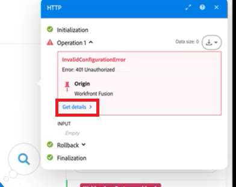

# Déboguer un scénario

L’outil Adobe Workfront Fusion Developer vous aide à comprendre et à résoudre les problèmes liés aux scénarios. À l’aide de l’outil Devtool, vous pouvez vérifier toutes les exécutions manuelles de votre scénario, passer en revue toutes les opérations effectuées et afficher les détails de chaque appel API effectué. Vous pouvez voir quel module, quelle opération ou quelle réponse unique a provoqué l’erreur et utiliser ces connaissances pour affiner votre scénario.

>[!NOTE]
>
>La connexion au panneau du débogueur sera limitée ou indisponible pour les scénarios confidentiels, les exécutions automatiques et les opérations réussies.

>[!NOTE]
>
>Dans la nouvelle expérience , plusieurs outils DevTool sont intégrés à l’éditeur de scénarios. Vous pouvez donc les utiliser sans ouvrir l’outil de développement :
>
>| Outil | Où le trouver dans la nouvelle expérience |
>| ---------- | ---------- |
>| Obtenir les métadonnées de l’application | Cliquez avec le bouton droit sur un module et sélectionnez **Métadonnées de l’application**. |
>| Copier le mappage | Cliquez avec le bouton droit sur le module source, sélectionnez **Copier le mappage**, puis collez-le sur un module compatible. |
>| Copier le filtre | Cliquez avec le bouton droit sur le lien filtré, sélectionnez **Copier le filtre**, puis collez-le sur un autre lien. |
>| Copier le nom du module | Cliquez avec le bouton droit sur un module et sélectionnez **Copier le nom du module** ou **Coller le nom du module**. |
>| Permuter la connexion | Ouvrez Rechercher et remplacer, puis utilisez l’onglet **Connexion**. |
>| Permuter la variable | Ouvrez Rechercher et remplacer, puis utilisez l’onglet **Variable**. |
>| Remapper la source | Ouvrez Rechercher et remplacer, puis utilisez l’onglet ****. |
>
>Ces outils sont également toujours disponibles dans l’onglet **Outils** de DevTool, ainsi que dans les modules Focus a, Rechercher des modules par mappage et Base 64. Vous pouvez également utiliser les fonctions de conversion `base64()` et binaire dans les mappages.
>
>Vous pouvez également afficher les détails de la requête et de la réponse directement à partir du [Live Trail](/help/workfront-fusion/manage-scenarios/live-trail.md) et l’historique de l’exécution dans l’éditeur de scénarios. Pour plus d’informations sur la recherche et le remplacement, voir [Rechercher et remplacer des variables, des sources et des connexions dans un scénario](/help/workfront-fusion/manage-scenarios/find-and-replace.md).
<!-- BECKY CHECK ME: DevTool screenshots (10/27/26) show all ten tools still on the Tools tab, so this note now says the seven built-in tools are available in both places. The release notes implied only Focus a module, Find modules by mapping, and Base 64 would remain. Confirm after release whether the other seven are removed from the DevTool, and update this note and the Tools section if so.  -->
<!-- BECKY CHECK ME: note added from the 10/23/26 release notes; the DevTool is NOT being removed. This article still needs a fuller restructure (new/classic split for the seven tools, Live Trail section or separate article). Confirm the menu labels. -->

Pour une vidéo d’introduction et une présentation de l’outil Fusion Devtool, voir

* [Outil de développement Fusion](https://video.tv.adobe.com/v/3427031/){target=_blank}
* [Présentation du développeur](https://experienceleague.adobe.com/fr/docs/workfront-learn/tutorials-workfront/fusion/troubleshooting-and-error-handling/dev-tool-walkthrough)

## Conditions d’accès

+++ Développez pour afficher les exigences d’accès aux fonctionnalités de cet article.

<table style="table-layout:auto">
 <col> 
 <col> 
 <tbody> 
  <tr> 
   <td role="rowheader">Package Adobe Workfront</td> 
   <td> 
Tout package de workflow Adobe Workfront et tout package d’automatisation et d’intégration Adobe Workfront

Workfront Ultimate

Packages Workfront Prime et Select, avec l’achat supplémentaire de Workfront Fusion.
 </td> 
  </tr> 
  <tr data-mc-conditions=""> 
   <td role="rowheader">Licences Adobe Workfront</td> 
   <td> 
Standard

Travail ou supérieur
 </td> 
  </tr> 
  <tr> 
   <td role="rowheader">Produit</td> 
   <td>
   
Si votre organisation dispose d’un package Workfront Select ou Prime qui n’inclut pas l’automatisation et l’intégration de Workfront, elle doit acquérir Adobe Workfront Fusion.</li></ul>
   </td> 
  </tr>
 </tbody> 
</table>

Pour plus d’informations sur le contenu de ce tableau, consultez [Conditions d’accès requises dans la documentation](/help/workfront-fusion/references/licenses-and-roles/access-level-requirements-in-documentation.md).

+++

## Accès à l’outil de développement

Si vous utilisez Fusion dans Adobe Unified Shell ou avez mis à jour votre expérience avec Fusion, vous pouvez accéder à l’outil Développement à partir de l’éditeur de scénarios.

### Accéder au Devtool dans la nouvelle expérience

1. Accédez à l’éditeur de scénarios pour le scénario que vous souhaitez déboguer.

   Pour localiser l’éditeur de scénarios, voir [L’éditeur de scénarios](/help/workfront-fusion/get-started-with-fusion/navigate-fusion/scenario-editor.md).

1. Cliquez sur l&#39;icône des trois points dans la zone Contrôles, puis sélectionnez **DevTool**.

Ou :

1. Accédez à l’éditeur de scénarios pour le scénario que vous souhaitez déboguer.
1. Effectuez un clic droit dans une zone vide de la page (et non dans un module).
1. Sélectionnez **Ouvrir le Devtool**.

L’outil de développement s’ouvre dans un panneau sous la zone de travail.

<!-- BECKY CHECK ME: new-experience access steps from your 10/27/26 notes (three-dot menu in Controls, or right-click). Confirm the menu label ('DevTool') and the 'panel below the canvas' description, and add a screenshot. I assumed the Helper tools icon steps below apply to the classic experience only; confirm. -->

### Accéder au Devtool dans l’expérience classique

1. Cliquez sur l’icône **Outils d’assistance**  située en bas de l’écran.

Ou :

1. Accédez à l’éditeur de scénarios pour le scénario que vous souhaitez déboguer.

   Pour localiser l’éditeur de scénarios, voir [L’éditeur de scénarios](/help/workfront-fusion/get-started-with-fusion/navigate-fusion/scenario-editor.md).

1. Cliquez avec le bouton droit dans une zone vide de la page (et non sur un module).
1. Sélectionnez **Ouvrir le Devtool**.

## Utilisation de l’outil de développement Workfront Fusion

L’outil de développement Workfront Fusion est divisé en 3 sections principales, ainsi qu’un lien d’aide. Vous pouvez les trouver dans le panneau de gauche de votre fenêtre Devtool.

* [Live Stream](#live-stream)
* [Débogueur de scénario](#scenario-debugger)
* [Outils](#tools)
* **Aide de DevTool** : cliquez sur l’icône de point d’interrogation pour ouvrir l’article sur l’outil de développement.

<!-- BECKY CHECK ME: the DevTool left panel now has a fourth item, 'DevTool help' (question mark icon), per your 10/27/26 screenshots. Confirm the label, that it opens this article or another one, and whether to apply this to the classic experience too. Retake the left-panel screenshot. -->

### Live Stream

Le Live Stream affiche ce qui se passe en arrière-plan lorsque vous cliquez sur Exécuter une fois dans votre scénario.

<!-- BECKY CHECK ME: HOLD: in the new experience, Live Stream shows a 'no events available' message even while a scenario is running, which may be a bug. No updates have been made to this section. Re-test after release before changing anything here. If it is intended behavior, this section may need to point to Live Trail instead. -->

1. Cliquez sur l’icône **[!UICONTROL Diffusion en direct]**  pour ouvrir la section Diffusion en direct .
1. Effectuez l’une des opérations suivantes :

   <table style="table-layout:auto"> 
    <col> 
    <col> 
    <thead> 
     <tr> 
      <th>Action</th> 
      <th>Instructions</th> 
     </tr> 
    </thead> 
    <tbody> 
     <tr> 
      <td role="rowheader">Afficher les informations sur la requête</td> 
      <td> 
Vous pouvez afficher les informations suivantes pour chaque module dans votre scénario.
 
       <ul> 
        <li> 
En-têtes de la requête (URL du point d’entrée de l’API, méthode HTTP, heure et date d’appel de la requête, en-têtes de la requête et chaîne de requête)
 </li> 
        <li> 
Corps de la requête
 </li> 
        <li> 
En-têtes de la réponse
 </li> 
        <li> 
Corps de la réponse
 </li> 
       </ul> 
Pour afficher ces informations, cliquez sur l’onglet approprié dans le panneau de droite de l’outil Workfront Fusion Devtool.
 </td> 
     </tr> 
     <tr> 
      <td role="rowheader"> 
Rechercher des événements par contenu
 </td> 
      <td> 
Saisissez le terme de recherche dans le champ de recherche du panneau de gauche de l’outil de développement Workfront Fusion pour afficher uniquement les requêtes contenant le terme de recherche.
 </td> 
     </tr> 
     <tr> 
      <td role="rowheader"> 
Effacer la liste des requêtes 
 </td> 
      <td> 
Cliquez sur l’icône de corbeille dans le coin supérieur droit du panneau de gauche du Devtool pour effacer la liste des requêtes enregistrées par le Devtool de Workfront Fusion. 
 </td> 
     </tr> 
     <!--
     <tr>
      <td role="rowheader"> 
Enable Console Logging
 </td> 
      <td> 
Click the computer icon  in the top-right corner of the Devtool's left panel.
 
Logging in the console is enabled when the computer icon is green.
 </td> 
     </tr>
     -->
     <tr> 
      <td role="rowheader"> 
Récupérer la requête au format JSON brut ou cURL
 </td> 
      <td> 
       <ul> 
        <li> 
<strong>JSON brut</strong> 
 
Cliquez sur <strong>[!UICONTROL Copy RAW]</strong> dans le coin supérieur droit du volet de droite du Devtool.
 </li> 
        <li> 
<strong>cURL</strong> 
 
Cliquez sur <strong>[!UICONTROL Copy cURL]</strong> dans le coin supérieur droit du volet de droite du Devtool.
 </li> 
       </ul> </td> 
     </tr> 
    </tbody> 
   </table>

### Débogueur de scénario

>[!NOTE]
>
>Pour accéder rapidement au débogueur à partir d’un scénario qui s’est avéré erroné, vous pouvez cliquer sur **Obtenir les détails** dans le message d’erreur figurant dans la sortie du module.
>
>

Le débogueur de scénario est utile pour les scénarios plus complexes. Il affiche l’historique du scénario qui s’exécute et vous permet de rechercher les modules par leur nom ou ID.

1. Cliquez sur l’icône **[!UICONTROL Débogueur de scénario]**  pour ouvrir le débogueur de scénario.

   Le débogueur de scénario répertorie les modules de votre scénario. Chaque module affiche son nom, l’application et l’action, ainsi qu’un badge numéroté avec l’identifiant du module.

1. (Facultatif) Saisissez le terme de recherche (nom ou ID de module) dans le champ **Rechercher des modules par nom ou ID**.
1. Cliquez sur le nom du module.

   Les cycles de l’exécution la plus récente du module sont répertoriés en regard de la liste des modules. Si le module ne contient aucune donnée d’exécution, le débogueur de scénario s’affiche **Aucun résultat trouvé**.

1. Développez un cycle, puis cliquez sur une opération.

   Chaque opération indique si elle a réussi et combien de temps elle a pris, par exemple **Opération 1** avec une durée de 0 ms.

1. Passez en revue les détails de la requête. Utilisez les onglets pour afficher :

   * **En-têtes de requête** : URL du point d’entrée de l’API, méthode HTTP, moment de l’appel de la requête et en-têtes de requête.
   * **Corps de la requête**
   * **En-têtes de réponse**
   * **Corps de réponse**

1. (Facultatif) Pour copier la requête, cliquez sur **Copier RAW** ou **Copier cURL**.

<!-- BECKY CHECK ME: Scenario Debugger steps expanded from your 10/27/26 new-experience DevTool screenshots. Confirm: (1) the 'Search modules by Name or ID' label; (2) that the module list sub-labels, badge (module ID), cycle/operation layout, and 'No Result found' state are described correctly; (3) the tab names, since Response Body was partly hidden behind the Copy buttons in the screenshot; (4) whether Copy RAW and Copy cURL copy the request only or the request and response; (5) whether the classic experience's Scenario Debugger looks the same, or this needs a new/classic split. The screenshot also shows a collapsed 'Live trail' tab with an event count on the right edge of the editor; see the Live Trail article. Retake the Scenario Debugger screenshots. -->

### Outils

L’outil de développement Workfront Fusion comporte des outils qui facilitent la configuration de votre scénario.

1. Cliquez sur l’icône **[!UICONTROL Outils]**  pour ouvrir les outils.
1. (Facultatif) Pour rechercher un outil, saisissez son nom dans le champ **Rechercher un outil par nom**.
1. Sélectionnez l’outil que vous souhaitez utiliser.
1. Configurez les champs comme indiqué ci-dessous.
1. Cliquez sur **[!UICONTROL Exécuter]**.

Jusqu’à ce que vous sélectionniez un outil, le côté droit du panneau vous invite à en sélectionner un. Un lien au bas de l’onglet Outils vous mène à l’article sur l’outil de développement.

<!-- BECKY CHECK ME: added from your 10/27/26 screenshots: the 'Search tool by name' field, the select-a-tool prompt, and the link to the DevTool article. Confirm the field label and link destination; retake the Tools screenshot. -->

Outils et leurs champs :

* [Cibler un module](#focus-a-module)
* [Rechercher des modules par mappage](#find-modules-by-mapping)
* [Obtenir les métadonnées de l’application](#get-app-metadata)
* [Copier le mappage](#copy-mapping)
* [Copier le filtre](#copy-filter)
* [Copier le nom du module](#copy-module-name)
* [Permuter la connexion](#swap-connection)
* [Permuter la variable](#swap-variable)
* [Base 64](#base-64)
* [Remapper la source](#remap-source)

#### [!UICONTROL Cibler un module]

Ouvre les paramètres du module spécifié par ID.

<table style="table-layout:auto">
    <tr>
        <td>[!UICONTROL Module ID]</td>
        <td>Saisissez l’ID du module pour ouvrir ses paramètres.</td>
    </tr>
</table>

#### [!UICONTROL Rechercher des modules par mappage]

Permet de rechercher les valeurs des modules pour un terme spécifique. La sortie inclut les ID des modules qui contiennent le terme recherché.

<table style="table-layout:auto">
 <col> 
 <col> 
 <tbody> 
  <tr> 
   <td role="rowheader">[!UICONTROL Keyword]</td> 
   <td> 
 Saisissez le terme à rechercher. 
 </td> 
  </tr> 
  <tr> 
   <td role="rowheader"> 
[!UICONTROL Use Only Values]
 </td> 
   <td> 
Activez cette option pour rechercher uniquement dans les valeurs des champs du module.
 
Désactivez cette option pour rechercher également dans les noms des champs du module.
 
La recherche est effectuée par le biais des paramètres de nom et de libellé.
 </td> 
  </tr> 
 </tbody> 
</table>

#### [!UICONTROL Obtenir les métadonnées de l’application]

Récupère les métadonnées de l’application par le nom ou l’ID du module de l’application. Cette fonction est utile, par exemple, lorsque vous devez connaître la version de l’application utilisée dans votre scénario.

<table style="table-layout:auto">
    <tr>
        <td>[!UICONTROL Source Module]</td>
        <td>Sélectionnez le module dont vous souhaitez récupérer les métadonnées.</td>
    </tr>
</table>

#### [!UICONTROL Copier le mappage]

Copie les valeurs du module source vers le module cible.

>[!CAUTION]
>
>Veillez à définir les modules source et cible appropriés. Si vous sélectionnez un autre type de module, les valeurs du module cible seront supprimées.

<table style="table-layout:auto">
 <col> 
 <col> 
 <tbody> 
  <tr> 
   <td role="rowheader">[!UICONTROL Source Module]</td> 
   <td> 
 Sélectionnez le module ou saisissez l’ID du module dont vous souhaitez copier les valeurs de champ.
 </td> 
  </tr> 
  <tr> 
   <td role="rowheader"> 
[!UICONTROL Target Module]
 </td> 
   <td> 
Sélectionnez le module ou saisissez l’ID du module dans lequel vous souhaitez insérer les valeurs du module source.
 
Important : les valeurs du module cible seront remplacées.
 </td> 
  </tr> 
 </tbody> 
</table>

#### [!UICONTROL Copier le filtre]

Copie les paramètres de filtre du module source vers le module cible.

>[!NOTE]
>
>L’action de copie est effectuée sur le filtre placé sur le côté gauche du module sélectionné.

<table style="table-layout:auto"> 
 <col> 
 <col> 
 <tbody> 
  <tr> 
   <td role="rowheader">[!UICONTROL Source Module]</td> 
   <td> 
 Sélectionnez le module ou saisissez l’identifiant du module à partir duquel vous souhaitez copier les valeurs de filtre.
 </td> 
  </tr> 
  <tr> 
   <td role="rowheader"> 
[!UICONTROL Target Module]
 </td> 
   <td> 
Sélectionnez le module ou saisissez l’identifiant du module dans lequel vous souhaitez insérer les valeurs de filtre du module source.
 
Important : les valeurs du module cible seront remplacées.
 </td> 
  </tr> 
  <tr> 
   <td role="rowheader"> 
[!UICONTROL Preserve Fallback Route setting]
 </td> 
   <td> 
Le filtre source est défini comme l’itinéraire de secours. Activez cette option pour définir également le filtre cible comme itinéraire de secours.
 </td> 
  </tr> 
 </tbody> 
</table>

#### [!UICONTROL Copier le nom du module]

Copie le nom du module sélectionné dans le presse-papiers.

<table style="table-layout:auto">
 <col> 
 <col> 
 <tbody> 
  <tr> 
   <td role="rowheader">[!UICONTROL Module] </td> 
   <td> 
Sélectionnez le module dont vous souhaitez copier le nom.
 </td> 
  </tr> 
 </tbody> 
</table>

#### [!UICONTROL Permuter la connexion]

Duplique une connexion du module source à tous les modules de la même application dans le scénario.

<table style="table-layout:auto">
    <tr>
        <td>[!UICONTROL Source Module]</td>
        <td>Sélectionnez le module ou saisissez l’identifiant du module à partir duquel vous souhaitez dupliquer la connexion.</td>
    </tr>
</table>

#### [!UICONTROL Permuter la variable]

Recherche les variables spécifiées dans le scénario et les remplace par une nouvelle variable.

<table style="table-layout:auto">
 <col> 
 <col> 
 <tbody> 
  <tr> 
   <td role="rowheader">[!UICONTROL Variable to Find]</td> 
   <td> 
 Recherchez la pilule de variable à remplacer dans le module de variable de votre scénario et copiez-la dans ce champ ([!UICONTROL Variable to Find]). Dans le champ, elle apparaît avec des accolades doubles. Exemple : <code>&#123;&#123;5.value&#125;&#125;</code>.
 </td> 
  </tr> 
  <tr> 
   <td role="rowheader"> 
[!UICONTROL Replace With]
 </td> 
   <td> 
Recherchez la pilule de variable avec laquelle vous souhaitez remplacer la variable dans le module de variables de votre scénario et copiez-la dans ce champ ([!UICONTROL Variable to Find]). Dans le champ, elle apparaît avec des accolades doubles. Exemple : <code>&#123;&#123;5.value&#125;&#125;</code>.
 </td> 
  </tr> 
  <tr> 
   <td role="rowheader"> 
[!UICONTROL Module]
 </td> 
   <td> 
Sélectionnez le module de variables dans lequel vous souhaitez remplacer la variable. Si aucun module n’est sélectionné, la variable sera remplacée dans l’ensemble du scénario.
 </td> 
  </tr> 
 </tbody> 
</table>

#### [!UICONTROL Base 64]

Permet de coder les données saisies en Base64 ou de décoder du Base64. Certaines requêtes sont codées en Base64. Cet outil est utile lorsque vous souhaitez rechercher des données spécifiques dans la requête codée.

<table style="table-layout:auto">
 <col> 
 <col> 
 <tbody> 
  <tr> 
   <td role="rowheader">[!UICONTROL Operation] </td> 
   <td> 
Indiquez si vous souhaitez coder les données du champ [!UICONTROL Raw Data] en Base64 ou décoder Base64 en données brutes.
 </td> 
  </tr> 
  <tr> 
   <td role="rowheader"> 
[!UICONTROL Raw Data]
 </td> 
   <td> 
 Saisissez les données que vous souhaitez encoder en Base64, ou les données Base64 que vous souhaitez décoder en données brutes, en fonction de l’option sélectionnée dans le champ [!UICONTROL Operation] ci-dessus.
 </td> 
  </tr> 
 </tbody> 
</table>

#### [!UICONTROL Remapper la source]

Vous permet de modifier la source de mappage d’un module à un autre.

Vous devez d’abord ajouter le module que vous voulez utiliser comme module source à l’itinéraire de votre scénario.

<table style="table-layout:auto"> 
 <col> 
 <col> 
 <tbody> 
  <tr> 
   <td role="rowheader">[!UICONTROL Source Module] </td> 
   <td> 
 Sélectionnez le module que vous souhaitez remplacer en tant que source de mappage pour les autres modules de votre scénario.
 </td> 
  </tr> 
  <tr> 
   <td role="rowheader"> 
[!UICONTROL Target Module]
 </td> 
   <td> 
Sélectionnez le module à utiliser comme nouvelle source de mappage.
 </td> 
  </tr> 
  <tr> 
   <td role="rowheader"> 
[!UICONTROL Module to Edit]
 </td> 
   <td> 
Sélectionnez le module pour lequel vous souhaitez modifier le mappage si vous ne souhaitez pas modifier le mappage dans l’ensemble du scénario. 
 </td> 
  </tr> 
 </tbody> 
</table>
